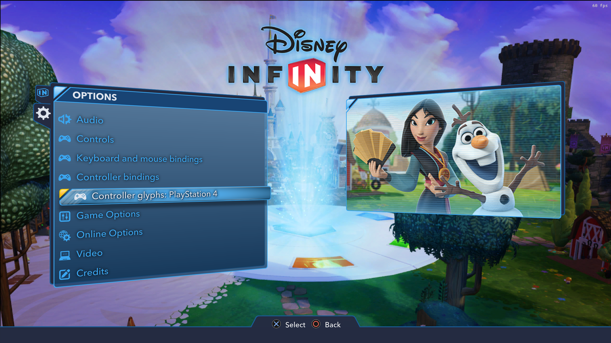
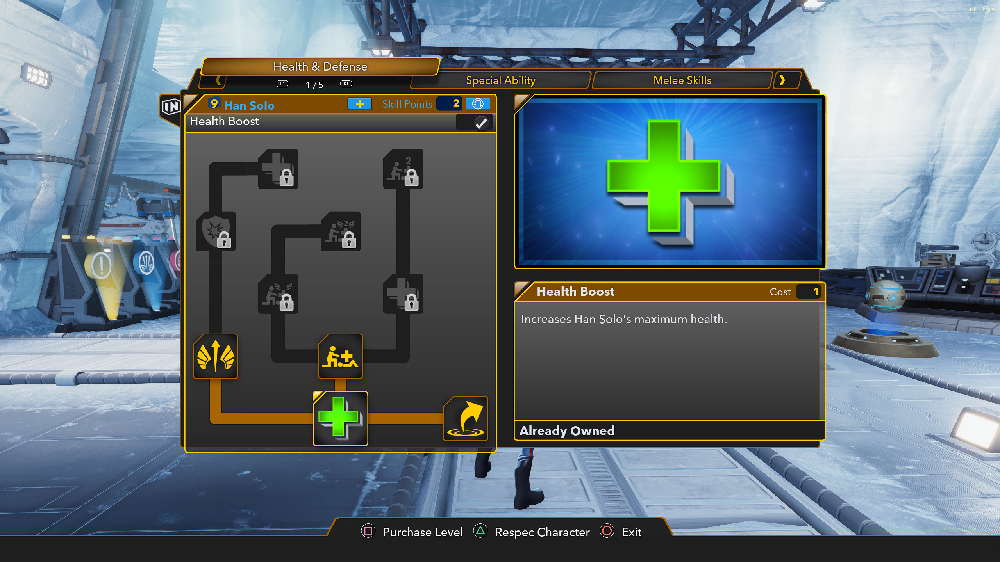
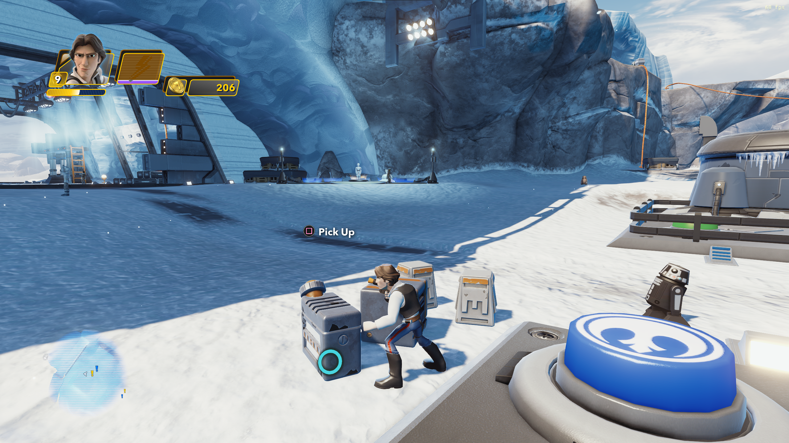
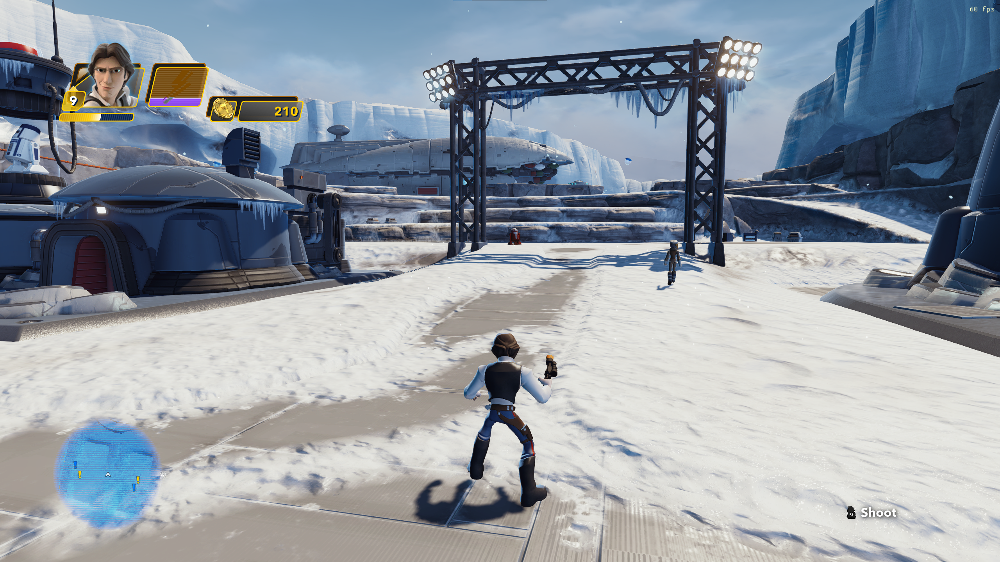

# PlayStation 4 Controller Glyphs for Disney Infinity 3.0: Gold Edition

Standalone CrabeLoader mod for **Disney Infinity 3.0: Gold Edition (Steam, Win32)**.
Change **Options > Controller glyphs** between **Xbox** and **PlayStation 4**. The
row appears immediately below **Controller bindings**, with the matching controller
icon. The selection is saved immediately and changes drawing within about 50 ms. Original
Xbox textures stay intact, so switching back does not require a restart.

## Screenshots

**Options menu.** The controller icon and current glyph style appear directly below
Controller bindings. Select the row to switch between Xbox and PlayStation 4.



**Skill tree.** PlayStation L1/R1 tab prompts and Square, Triangle, and Circle
button prompts in Han Solo's skill menu.



**Gameplay prompts.** Square for Pick Up and R2 for Shoot.





## Install

1. Close the game. Install **[CrabeLoader v1.1.0 or newer](https://github.com/LucasLhomme/CrabeLoader/releases/latest)** using its `CrabeInstaller.exe`. The v1.1.0 installer places `dinput8.dll` and `CrabeLoader.asi` beside `DisneyInfinity3.exe`. If you already use another ASI loader, follow [CrabeLoader's installation instructions](https://github.com/LucasLhomme/CrabeLoader/blob/v1.1.0/README.md#installation).
2. Download **`di3-ps4-glyphs-0.1.5.zip`** from this mod's **[GitHub release](https://github.com/lightningcal/di3-ps4-glyphs/releases/tag/v0.1.5)**. Choose the named distribution ZIP under **Assets**; GitHub's automatic **Source code** downloads do not include the compiled plugin.
3. Extract the ZIP **into the game folder containing `DisneyInfinity3.exe`**, merging the included `mods` folder. In Steam, use **Manage > Browse local files** to locate the game. Do not extract it into an existing `mods` folder, which would produce `mods/mods`.
4. Confirm the resulting layout:

   ```text
   Disney Infinity 3.0 Gold Edition/
     DisneyInfinity3.exe
     dinput8.dll
     CrabeLoader.asi
     mods/
       ps4-glyphs/
         mod.json
         main.lua
         PS4Glyphs.asi
         glyphs/*.png
   ```

5. Launch the game and open **Options**. Select **Controller glyphs: Xbox**, directly below **Controller bindings**, to switch to **PlayStation 4**. Select the same row again to switch back. CrabeMenu is optional.

Native ASI plugins must be enabled. If you previously disabled them, set `asi = true`
under `[plugins]` in `Crabe/crabe.toml` and ensure `PS4Glyphs.asi` is absent from the
`skip` list. Restart the game after installing or updating the native plugin or artwork;
F4 reloads Lua only. See [CrabeLoader's native plugin guide](https://github.com/LucasLhomme/CrabeLoader/blob/v1.1.0/docs/guides/asi_plugins.md).

The option is also registered on the in-game Options menu. Xbox is the default on
first use. The preference is saved in `mods/ps4-glyphs/settings.json`. When updating,
close the game and extract the new ZIP over the old installation; the distribution
contains no settings file, so your preference is preserved. A standalone copy of
these steps is included as [INSTALL.md](INSTALL.md).

Remove only `mods/ps4-glyphs` while the game is closed to uninstall. No original
game archive, executable, controller mapping, CrabeLoader binary, or other mod is
changed. CrabeMenu is optional. This changes displayed glyphs only; a PS4
controller must already work in the game, for example through Steam Input.

## Build and test

Requires Visual Studio 2022 C++ Build Tools, the Windows SDK, and CMake 3.21+.

```powershell
.\build.ps1
.\build.ps1 -Install -GameDir 'X:\SteamLibrary\steamapps\common\Disney Infinity 3.0 Gold Edition'
```

Builds **Win32/x86**, runs CTest, and makes the installation ZIP under `dist/`.
The Lua settings tests also run when a Lua 5.1 interpreter is found; CMake looks
for `crabe_lua`/`lua51`/`lua5.1`/`lua`, including the adjacent CrabeLoader build.
Override with `-DCRABE_LUA=C:/path/to/crabe_lua.exe` when configuring CMake.
No CrabeLoader source or import library is required to build the plugin.

The optional `test_renderer` executable runs the real ASI against a real D3D11
device using a small SDK host. Pass a local vanilla 45x45 button DDS as its second
argument; it renders and reads back GPU pixels for both immediate and deferred contexts,
both upload paths, PlayStation replacement, and Xbox restoration. The vanilla DDS is never shipped. Configure
`-DPS4_GLYPH_TEST_DDS=C:/path/to/button.tbody` to include this check in CTest.

## How it works

- `mod/main.lua` uses the documented mod lifecycle, `Crabe.Settings.addOption`,
  `Crabe.Storage`, and `Crabe.Plugins` bridge.
- `PS4Glyphs.asi` receives the published `CrabePluginApi`. It installs D3D11
  texture-upload and pixel-shader binding hooks for both immediate and deferred
  contexts through the loader's hook registry. Deferred command lists are covered.
- The plugin matches the **pixel fingerprints** of the 31 standard PC controller
  icon names, with row-padding independence and BGRA/RGBA variants. It substitutes
  generated PNG artwork only when enabled. Unknown textures pass through.
- Replacement shader views belong to original resources through COM private data,
  so texture lifetimes and device recreation do not leave stale pointer mappings.
- All game UI and persistence stay on the Lua thread. Rendering calls no Lua,
  does no disk I/O, and polls the shared setting at most 20 times per second.

`assets/glyph-map.json` records the reviewed game texture identifiers and pixel
fingerprints. No original game textures or compiled game scripts are distributed.
Plala-specific glyph variants, baked controller diagrams, and button names written
as ordinary text are outside the replacement set. The game reuses the same texture
for each stick's generic/top-view icon; those share the L3/R3 artwork here.
PS and touchpad artwork are supplied, but the PC game has no corresponding Xbox
prompt to replace. This does not add new PS/touchpad input actions.

## Artwork

36 transparent PNG assets live in `mod/glyphs/`, including face buttons, shoulders,
triggers, Options, Share, L3/R3, D-pad directions, stick directions, PS and touchpad.
They were generated with the built-in imagegen tool. See `assets/PROMPT.md`.
`assets/ps4-glyph-atlas.png` is the preserved source. Its generated spacing differs
from the requested uniform grid, so `assets/atlas.json` contains reviewed crop
rectangles. `tools/split-atlas.ps1` extracts and centers each glyph without clipping.
`python tools/build_fingerprints.py` regenerates the hash-only C++ table from JSON.

## Verification status

Version **0.1.2** also fixes a stale option label caused by inherited settings
rows: it updates the displayed row. Version **0.1.4** preserved focus when changing the setting. Version **0.1.5**
uses the native icon-capable menu button because LR_Toggle has no icon clip.
Select switches the choice and updates just that button, preserving focus.
Version 0.1.1 fixed the renderer's missing deferred-context hooks.
The GPU test draws and reads back actual pixels for both rendering context types,
both upload paths, and both toggle states. All three CTest suites pass. The live
running game records controller-glyph substitutions and has one visible Options
screen; see `VALIDATION.md` for evidence. The menu refresh ignores hidden screens.

## Troubleshooting

Search `loader.log` for `PS4Glyphs.asi`. A successful startup reports
`PS4 glyph renderer ready` followed by `Matched vanilla glyph` lines. If the native
plugin is unavailable, the Lua mod reports the problem instead of showing an active
setting. Enable native ASI plugins in `Crabe/crabe.toml` if previously disabled.
Restart after changing the ASI or artwork; F4 reloads Lua only.

In the CrabeLoader console:

```lua
return Crabe.Plugins.get('di3.ps4.ready'),
       Crabe.Plugins.get('di3.ps4.matched'),
       Crabe.Plugins.get('di3.ps4.substitutions')
```

## References

Implementation follows the publisher's guides, read online on 2026-10-16:

- [Mod Development Guide](https://github.com/LucasLhomme/CrabeLoader/blob/main/docs/guides/mods.md)
- [Native ASI Plugins and SDK](https://github.com/LucasLhomme/CrabeLoader/blob/main/docs/guides/asi_plugins.md)
- [Loose Texture Overrides and Cache Limitations](https://github.com/LucasLhomme/CrabeLoader/blob/main/docs/guides/vfs_textures.md)
- [API Definitions](https://github.com/LucasLhomme/CrabeLoader/blob/main/docs/crabe_api.def.lua)

The plugin SDK header is copied unmodified from CrabeLoader; its license is in
`third_party/CrabeLoader-LICENSE`. Project source is GPL-3.0; see `LICENSE`.
PlayStation button imagery identifies controller controls; this is an unofficial mod.
